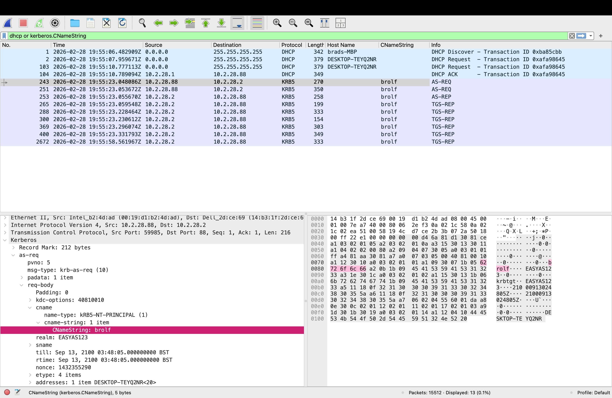
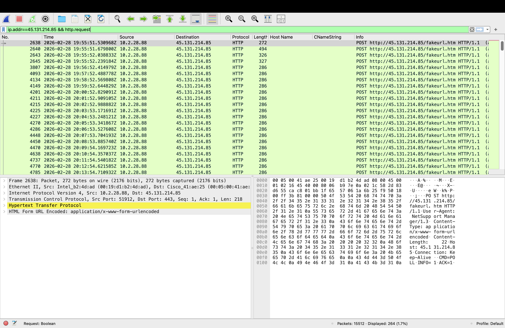
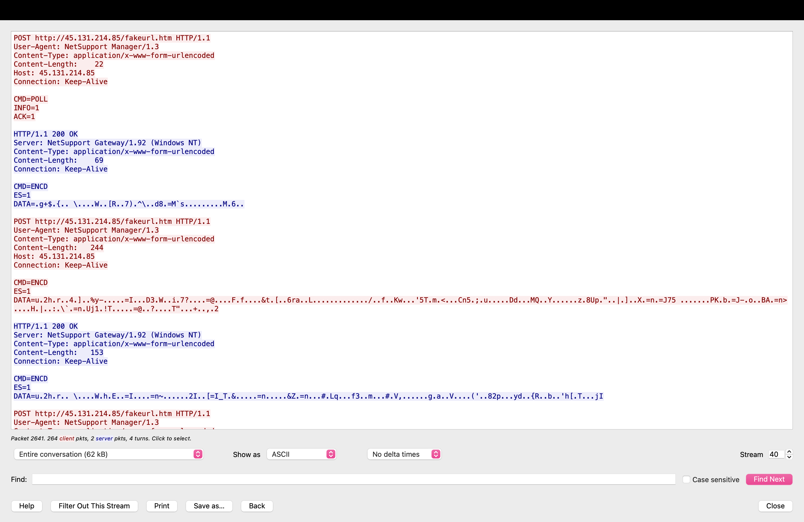
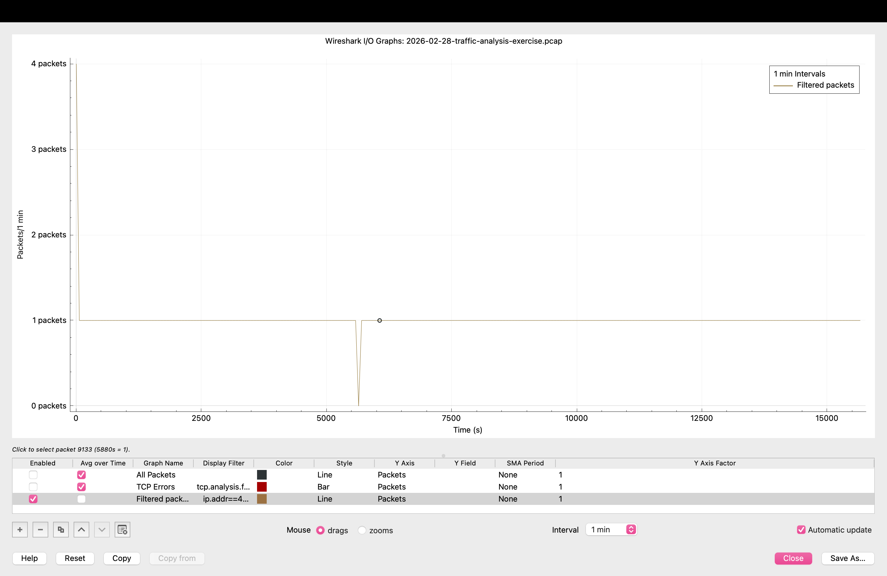

# Case 01: Malware infection, finding the C2 (NetSupport RAT)

> **Status:** ✅ complete

| | |
|--|--|
| **Source** | malware-traffic-analysis.net: *2026-02-28 Traffic analysis exercise: "Easy as 123"* (<https://www.malware-traffic-analysis.net/2026/02/28/index.html>) |
| **Capture file** | `2026-02-28-traffic-analysis-exercise.pcap`, 15,512 packets, 6.3 MB |
| **SHA-256** | `3dc470f5490ec15b4024c513e87c67e0b17caeae2a2ce3d83541be24ef407e61` |
| **Time span (UTC)** | 2026-02-28 19:55:06 → 2026-03-01 00:16:35 (4 h 21 min) |
| **Analyst** | Mandara Hassan Puttaswamy |
| **Verdict** | **Malicious**: an active NetSupport Manager RAT infection with command-and-control |

## 1. Executive summary
Windows workstation **DESKTOP-TEYQ2NR** (`10.2.28[.]88`, user **brolf**, domain `EASYAS123.TECH`) is infected with **NetSupport Manager RAT**, a legitimate remote-administration tool abused by attackers. Starting 45 seconds into the capture, the host checks in with the attacker's server `45.131.214[.]85` on port 443 **every ~60 seconds** (264 check-ins), until the capture ends 4 h 21 min later. Threat intel (ThreatFox) independently lists this IP:port as NetSupport C2. The attacker could take full remote control of the machine and the user's domain session. **Recommended action:** isolate the host, block the IP and domain at the perimeter, reset the brolf credentials, and hunt for `client32.exe` / NetSupport files on other endpoints.

## 2. Infected host
| Field | Value | Evidence |
|-------|-------|----------|
| IP address | `10.2.28[.]88` | DHCP (19:55:07); busiest internal host (7,386 packets) |
| MAC address | `00:19:d1:b2:4d:ad` | DHCP request |
| Hostname | `DESKTOP-TEYQ2NR` | DHCP option 12 + NBNS registration |
| User account | `brolf` | Kerberos `CNameString`, realm `EASYAS123.TECH` |
| User's full name | **Becka Rolf** | **SAMR** (Windows account-management RPC) reply to the DC lookup: `Account Name: brolf … Full Name: Becka Rolf` |
| Domain controller | `10.2.28[.]2` (`EASYAS123-DC`) | Kerberos/LDAP traffic + DNS |



*A single Kerberos login packet links all four identifiers: MAC (Ethernet), IP (IP header), user and realm (`CNameString`, `realm`), and hostname (`addresses: DESKTOP-TEYQ2NR<20>`).*

*Noise dismissed:* a DHCP packet from `brads-MBP` (MAC `00:e0:4c:68:08:00`, no IP) is a different device, most likely the capture author's machine. It has no other traffic, so it's not part of the incident.

## 3. Timeline (UTC, 2026-02-28 unless noted)
| Time | Event | Evidence |
|------|-------|----------|
| 19:55:06 | Capture starts | `capinfos` |
| 19:55:07 | Host requests IP via DHCP as DESKTOP-TEYQ2NR | `dhcp` |
| 19:55:09–19:55:34 | Normal Windows start-up traffic (connectivity test, Edge, Office, MSN, telemetry) | `http.request or tls.handshake.type==1` |
| 19:55:50.96 | DNS lookup `www.fmcsa.dot.gov` → `23.64.147[.]24`, then a ~1.1 MB HTTPS download | DNS + conversations (see *Open questions*) |
| **19:55:51.37** | **DNS lookup `vadusa[.]xyz` → `45.131.214[.]85`** | `dns.qry.name contains "vadusa"` |
| **19:55:51.37** | **First packet to the C2** (TCP SYN to port 443) | `ip.addr==45.131.214.85` |
| 19:55:51.53–19:55:52.24 | 4 rapid HTTP POSTs to `/fakeurl.htm`: initial registration | `http.request` |
| 19:56:52 → | One POST every ~60 s for the rest of the capture | `beacon-check.py` |
| 2026-03-01 00:16:28 | Last C2 packet. Infection still active when the capture ends | `ip.addr==45.131.214.85` |

## 4. Analysis

### 4.1 Where I looked first and why
I ran `tools/triage.sh` for a one-page overview, then `tools/host-id.sh` to pin down the victim. With an infection already confirmed, the quickest route to the C2 is the **plain-text web traffic**: HTTP is unencrypted, so anything malicious there can be read directly.

### 4.2 Finding 1: plain HTTP on port 443 (protocol mismatch)
```
264  443  POST  http://45.131.214.85/fakeurl.htm  NetSupport Manager/1.3
```
- **Port 443 should carry TLS (HTTPS).** Here it carries **unencrypted HTTP**. Attackers use 443 because firewalls almost always allow it out, then skip the encryption. That mismatch is a strong signal on its own.
- **The User-Agent reads `NetSupport Manager/1.3`.** The client names itself.
- **`/fakeurl.htm` is a known NetSupport C2 URI.** The request line also contains a **full URL** (`http://…/fakeurl.htm`), which is proxy-style and unusual for a normal browser request.
- **It goes to a raw IP rather than a domain**, which is rare for legitimate software.
- **The POST body is `CMD=POLL INFO=1 ACK=1`.** The RAT is asking its server "any commands for me?" on every check-in.
- **Packet sizes:** the first 4 POSTs vary (272 / 494 / 326 / 327 bytes): the RAT registering. After that, every check-in is **exactly 286 bytes**. A constant size at a fixed interval is a second beaconing signature, alongside the timing.



**Following the stream** (right-click a POST → Follow → HTTP Stream) shows both sides:

| Side | What it shows | Meaning |
|------|---------------|---------|
| Client (red) | `CMD=POLL`, `INFO=1`, `ACK=1` | "I'm here, any commands?" |
| Server (blue) | `Server: NetSupport Gateway/1.92 (Windows NT)` | **The C2 identifies itself** as a NetSupport Gateway, the relay attackers use to control victims |
| Both | `CMD=ENCD`, `ES=1`, `DATA=<binary>` | After the first poll, commands and data travel **encrypted inside the HTTP body** |

- The command content can't be read without NetSupport's keys. But the **headers alone** (user-agent, server banner, URI, port mismatch, timing) confirm the C2 without decrypting anything.
- The whole 4-hour exchange is **one TCP stream (stream 40, 62 kB)**. That proves why per-connection counting would miss this beacon.



### 4.3 Finding 2: regular beaconing
`tools/beacon-check.py` on the C2 requests:
```
flag    src           dst:port              conns  mean_gap_s   cv
BEACON  10.2.28.88    45.131.214.85:443       264        59.5  0.11
```
- **The mean gap is 59.5 s**, so the RAT checks in roughly once a minute.
- **CV 0.11** means the gaps barely vary. Humans browse irregularly (CV ≈ 1); a timer doesn't.
- **I measured HTTP requests, not new connections.** NetSupport keeps one TCP session open and sends each check-in inside it, so counting SYNs would hide the beacon almost completely.
- **Why the mean is 59.5 s rather than 60:** the 4 registration POSTs in the first second pull the average down. The steady interval between check-ins is **~60.1 s** (19:56:52 → 19:57:52 → 19:58:52 …).

**I/O graph** (Statistics → I/O Graphs, filter `ip.addr==45.131.214.85 && http.request`, interval 1 min):



- **Spike to 4** in minute one: the registration burst.
- **Flat at exactly 1 per minute** for 4 h 21 min: a timer, not a person. Normal traffic looks jagged.
- **One dip to 0 at ~5,650 s:** checked against the raw timestamps (`commands.sh`, "gaps > 90 s"), and **no gap between check-ins exceeds 90 s, so no beacon was missed.** The dip is a **binning artefact**: the beacon period (~60.14 s) is slightly longer than the 60 s graph bins, so each check-in lands ~0.14 s later in its bin. After ~100 check-ins one crosses a bin edge, leaving one bin empty. *Lesson: verify a chart anomaly against raw data before reporting it.*

### 4.4 Finding 3: the domain behind the IP
`vadusa[.]xyz` resolves to `45.131.214[.]85` 2 ms before the first C2 packet. That links the domain to the C2, and suggests the RAT's config file holds the domain, which is then resolved. A cheap `.xyz` domain that appears nowhere else in the capture fits attacker infrastructure.

### 4.5 Finding 4: independent confirmation
ThreatFox (abuse.ch) lists `45.131.214[.]85:443` as **botnet_cc for NetSupportManager RAT** (IOC ID 1755776). The network evidence and the threat intel agree.

### 4.6 What is NOT in this capture
There's **no initial infection step** (no payload download, phishing link or script) before the first check-in. The C2 starts 45 s after the PC boots and logs in, which suggests the RAT was **already installed and started via persistence** (e.g. a Run key or Startup folder). The initial access happened before this capture began. Endpoint logs would be needed to find it.

### 4.7 Ruled out as normal
- **Ports 389 / 88 / 135 / 445 / 49671** go to the DC: LDAP, Kerberos, RPC, SMB. That's normal domain traffic.
- **`wpad.*` lookups (157)** are Windows proxy auto-discovery, normal though noisy. (It *can* be abused, but nothing here answered with a proxy.)
- **Microsoft/MSN/Office/Edge/Adobe** HTTPS: SNI and IPs match normal Windows background traffic.

### 4.8 Checked and ruled out (were open questions)
- **TCP port 62068 → DC.** Three short sessions from the victim to the domain controller (`10.2.28[.]2`) at 19:55, 21:25 and 22:55, **exactly 90 minutes apart**. Each is a complete handshake, a small exchange and a clean FIN close. That's a dynamic RPC port on the DC, and the 90-minute rhythm matches Windows' default **Group Policy refresh**. Internal, well-formed, expected: **benign.** *Lesson: an unusual port number means nothing without context. Check who it talks to and how.*
- **`www.fmcsa.dot.gov` (`23.64.147[.]24`).** One HTTPS session, with the SNI matching the DNS lookup. It's a legitimate US government site, and ~1.1 MB fits a normal page load. It happened in the same second the RAT started, but nothing links it to the C2. **Not an IOC.** (A decoy page opened by the malware can't be ruled out without endpoint logs.)

## 5. Indicators of compromise
Full list: [`iocs.csv`](iocs.csv). All defanged.

| Type | Indicator | Context |
|------|-----------|---------|
| IP:port | `45.131.214[.]85:443` | NetSupport C2 (ThreatFox-confirmed) |
| Domain | `vadusa[.]xyz` | Resolves to the C2 IP immediately before first contact |
| URL | `hxxp://45.131.214[.]85/fakeurl.htm` | C2 check-in, HTTP POST |
| User-Agent | `NetSupport Manager/1.3` | C2 client identifier |
| Server banner | `NetSupport Gateway/1.92 (Windows NT)` | C2 server's HTTP `Server:` header |

## 6. Detection opportunity
- **ATT&CK:** T1219 (Remote Access Software) · T1071.001 (Application Layer Protocol: Web Protocols) · T1571 (Non-Standard Port: cleartext HTTP on 443) · T1547.001 (persistence, inferred)
- **Logic (plain English):**
  1. Alert on **unencrypted HTTP to an external host on port 443**.
  2. Alert on the **`NetSupport Manager` User-Agent** to any external IP not in the IT allow-list.
  3. Alert on a **`NetSupport Gateway` Server header** coming *from* the internet. Your own gateway would be internal, so an external one is the attacker's.
  4. Alert on **one host → one rare external IP at a steady interval** (low CV over 20+ requests).
- **Rule sketch (Suricata):**
  ```
  alert http $HOME_NET any -> $EXTERNAL_NET any (msg:"NetSupport RAT C2 check-in"; flow:established,to_server; http.method; content:"POST"; http.user_agent; content:"NetSupport Manager"; http.uri; content:"fakeurl.htm"; classtype:trojan-activity; sid:1000001; rev:1;)
  alert http $HOME_NET any -> $EXTERNAL_NET 443 (msg:"Cleartext HTTP to port 443"; flow:established,to_server; classtype:policy-violation; sid:1000002; rev:1;)
  alert http $EXTERNAL_NET any -> $HOME_NET any (msg:"NetSupport Gateway C2 response"; flow:established,to_client; http.server; content:"NetSupport Gateway"; classtype:trojan-activity; sid:1000003; rev:1;)
  ```
- **False positives:** organisations that use NetSupport legitimately (schools, IT support) will trigger rule 1. Check against the software inventory and allow-list the company's own NetSupport gateway. Rule 2 also catches some badly configured legitimate apps.
- **Why behaviour beats IOCs here:** the IP and domain will change in the next campaign, but "cleartext HTTP on 443 with a regular 60-second rhythm" won't.

## 7. Validation against the official answers
| Question | My answer | Official | |
|---|---|---|---|
| IP / MAC / host | 10.2.28.88 / 00:19:d1:b2:4d:ad / DESKTOP-TEYQ2NR | same | ✅ |
| User account | brolf | brolf | ✅ |
| Full name | Becka Rolf (added after the check: I'd missed this question at first) | Becka Rolf | ✅ |
| C2 | 45.131.214.85:443 | same | ✅ |

**The answer key contradicts itself:** its text says *Becka Rolf*, but a screenshot caption says *Gabriel Wyatt*. Decoding every packet (`tshark -V | grep -i wyatt`) finds **no "Wyatt" anywhere in the capture**, so the caption is a copy-paste error. *Lesson: verify answers against the evidence, even official ones.*

**How the full name was found:** Windows stores names in **UTF-16** (a zero byte between letters), so a plain byte search for "Rolf" fails. Decoding the packets first (`tshark -V`, or Wireshark's *Find Packet → Packet details*) finds it in a **SAMR** reply from the domain controller.

## 8. Reproduce
All commands: [`commands.sh`](commands.sh). The PCAP is not in this repo; download it from the source link (password: `infected_20260228`).

## 9. What I learned
- **Encryption isn't always there.** Checking whether a port carries the protocol it should (443 → TLS) is a quick, strong signal.
- **How you measure beaconing matters.** Long-lived C2 sessions hide in connection counts but stand out in request timing.
- **A capture shows only its own time window.** This one starts *after* the infection. Being clear about what the evidence can't show is part of the report.
