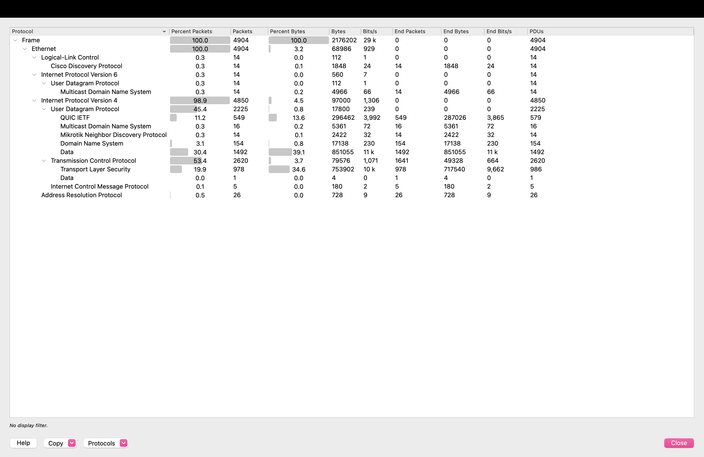

# Case 05: Clean baseline (what normal looks like) and testing my own detections

> **Status:** ✅ complete

| | |
|--|--|
| **Source** | Self-generated: `tools/capture-baseline.sh 10 en0`, ~10 minutes of my normal Mac use over Wi-Fi (browsing, email, video, background apps) |
| **Capture** | 4,904 packets, 2.2 MB, 594 s |
| **Privacy** | The pcap is **not published**. It contains my addresses and browsing. Only **aggregate numbers** appear here: no IP addresses and no sites I visited. The only domains named are the two generic false positives, because they *are* the finding |

## 1. Summary
I ran **every detection from cases 01–04 against my own clean traffic**. Four of the five produced **zero alerts**. The fifth, the DNS-exfiltration scorer from case 04, raised **two false positives**. Both were explained and fixed by tuning the rule, and the real exfiltration is still detected. The baseline also shows what modern "normal" looks like: **no plain HTTP at all, and over half the bytes over QUIC (UDP)**.

## 2. Why a baseline matters
You can't call something abnormal without knowing normal. Every threshold in this repo ("too many ports", "names too long", "too regular") only means something compared with real clean traffic. Testing detections against it is how a SOC keeps false positives down, and false positives are what bury real alerts.

## 3. What normal looks like (aggregate)
| Measure | My normal traffic |
|---------|-------------------|
| Packets / duration | 4,904 in 594 s (~8 pkt/s) |
| **Plain (unencrypted) HTTP requests** | **0** |
| TLS client hellos | 76, **all with a hostname (SNI)** |
| **QUIC (HTTP/3 over UDP 443)** | ~2,040 packets, **~1.2 MB of the 2.2 MB total** (see §3.1) |
| DNS queries | 88 (~9 per minute), average name length **28.8** |
| DNS record types | A (39), **HTTPS/type 65 (38)**, PTR (mDNS), **TXT: 0** |
| Distinct TCP destination ports | 3 |
| Local-network chatter | CDP and MNDP (switches/routers announcing themselves), mDNS, ARP, and a regular connection to a local **AirPlay** device (TCP 7000) |



| Share of bytes | Protocol |
|---|---|
| **39.1%** | UDP "Data" (QUIC Wireshark couldn't label, see §3.1) |
| **13.6%** | QUIC (labelled) |
| **34.6%** | TLS (HTTPS over TCP) |
| 0.8% | DNS |
| **0%** | **Plain HTTP** |

**QUIC ≈ 53% of all bytes**, more than classic HTTPS, and **no plain HTTP at all**.

### 3.1 The "unknown" UDP was QUIC
Wireshark labelled 1,492 UDP packets (914 KB) as generic `data`. Checking ports and timing:
```
 895  <my-port> → 443/udp          one connection, present from 2.7 s to 594 s
 523  443 → <my-port>
```
UDP 443 is **QUIC**. Wireshark recognises QUIC from its **handshake**, but this long-lived connection (likely a video stream or an always-connected app) **started before the recording**, so only mid-connection encrypted packets were seen and they couldn't be identified. *Lesson:* add this to the 549 packets Wireshark did label as QUIC, and **over half of normal web bytes don't use TCP at all**. Detection that only inspects TCP and TLS handshakes misses most of today's traffic.

## 4. Testing every detection from cases 01–04 against clean traffic
| Detection (case) | In the attack | In my normal traffic | Result |
|------------------|---------------|----------------------|--------|
| Cleartext HTTP on port 443 (01) | 264 requests | **0** | ✅ no false positives |
| Beaconing (`beacon-check.py`) (01, 02) | flagged (CV 0.11 / robust CV 0.00) | **nothing flagged** (most regular flow: local AirPlay, robust CV 0.65) | ✅ |
| HTTP with **no User-Agent** (02) | 593 requests | **0** (no plain HTTP at all) | ✅ |
| TLS SNI is a **bare IP** (02) | yes | **0 of 76** hellos | ✅ |
| TLS with **no SNI** (02) | yes | **0 of 76** | ✅ |
| Distinct ports to one host (03) | **1,026** | **1** | ✅ huge margin for a ">100 ports" threshold |
| DNS TXT queries (04) | 41 of 41 | **0** | ✅ |
| **DNS anomaly scorer (04)** | `exfil.test` scored 3/3 | **2 domains flagged** | ⚠️ **false positives, so tuned** |

### 4.1 The two DNS false positives, and the fix
```
score 2   _tcp.local   11 queries   3 unique subs   avg len 61.3   entropy 3.97
score 2   azure.com     2 queries   2 unique subs   avg len 49.5   entropy 4.01
```
- **`_tcp.local`** is **mDNS**: my Mac discovering devices and services (AirPlay, printers) on the local network. The names are long because they contain device and service names. `.local` is link-local and **never leaves the LAN**, so it can't carry data out.
- **`azure.com`**: Microsoft cloud services use long, random-looking hostnames (load-balancer and CDN IDs).
- **Root cause:** the scorer flagged any domain matching **2 of 3** signals. Both scored on **length + entropy**, but neither had **volume** (only 2–3 unique subdomains, against **41** for the real exfiltration).
- **Fix (in `tools/dns-anomaly.py`):** skip `.local`, and flag only if **unique subdomains ≥ 20 AND (avg length > 40 OR entropy > 3.5)**. Exfiltration *needs* volume to move data, so requiring it costs nothing in detection.
- **Re-tested on the real captures:** case 04 → `exfil.test` still flagged (41 unique subdomains). Baseline → **nothing flagged**: `azure.com` still scores 2 but isn't flagged (only 2 unique subdomains), and `.local` is skipped.

## 5. What I learned
- **Test detections against clean data before trusting them.** My own rule had a 2-in-9 false-positive rate on parent domains in just 10 minutes of normal use.
- **Explain a false positive, then tune for its cause.** Allow-listing `azure.com` would have hidden the real flaw (no volume requirement).
- **Modern normal is encrypted, and mostly QUIC.** Plain HTTP to a raw IP (cases 01 and 02) stands out precisely *because* it has essentially disappeared from normal traffic.
- **Unidentified doesn't mean malicious.** The "unknown" UDP turned out to be QUIC once I checked its ports and timing.

## 6. Reproduce
All commands: [`commands.sh`](commands.sh). Capture with `tools/capture-baseline.sh 10 en0`. The false-positive checks are the case 01–04 filters run against `baseline.pcapng`.
